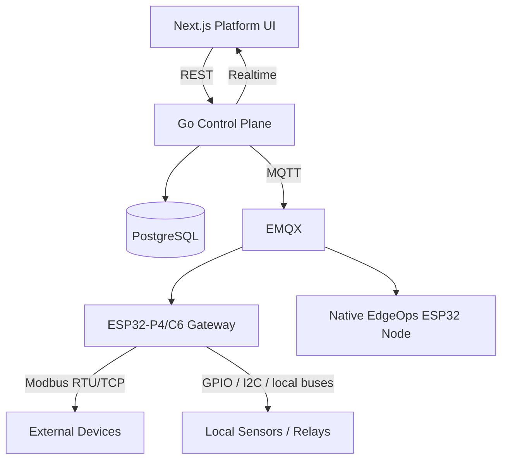
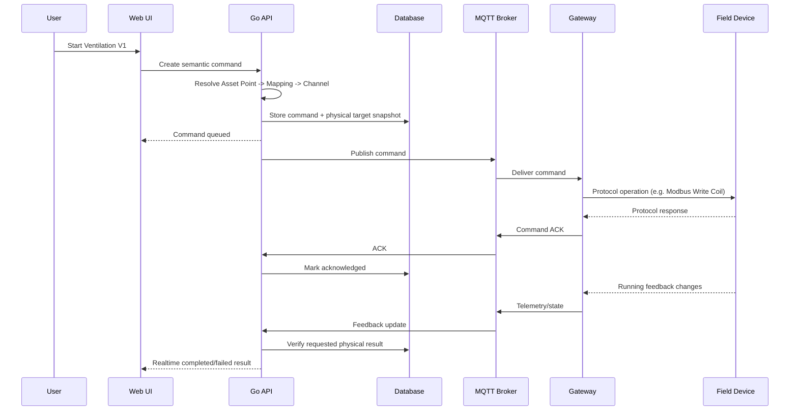
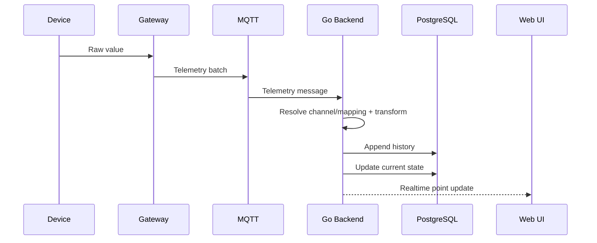

# EdgeOps Architecture v1

## 1. Purpose

EdgeOps is a distributed cloud-edge platform for centralized monitoring, configuration, control, diagnostics, and lifecycle management of IoT and edge infrastructure across multiple customer sites.

It is designed for engineering companies, system integrators, service organizations, and customers who operate distributed physical infrastructure.

The system intentionally separates:

- the **physical representation** of hardware;
- the **semantic representation** of real-world equipment;
- the **commercial/tenant representation** of customers and sites.

## 2. Primary users

### Platform administrator

Operates the EdgeOps SaaS/product itself.

Responsibilities:

- organizations/customers;
- plans and limits;
- platform health;
- global firmware catalog;
- support and internal administration.

### Organization administrator

Manages one customer's EdgeOps workspace.

Responsibilities:

- users and roles;
- sites;
- access policy;
- organization settings.

### Engineer / installer

Works with hardware and commissioning.

Responsibilities:

- gateways;
- devices;
- protocols;
- device profiles;
- channels;
- mappings;
- diagnostics;
- firmware;
- commissioning.

### Customer operator / viewer

Works with logical equipment rather than raw controllers.

Responsibilities:

- assets;
- current state;
- alarms;
- telemetry history;
- permitted controls;
- reports.

## 3. High-level system



## 4. Architectural planes

### 4.1 Presentation plane

Implemented by the Next.js frontend.

Provides:

- Customer Portal;
- Engineer Workspace;
- Organization Administration;
- Platform Administration.

The frontend must not own domain truth. It renders and manipulates backend resources.

### 4.2 Cloud control plane

Implemented initially as a Go modular monolith.

Responsibilities:

- identity and authorization;
- tenancy;
- sites;
- gateways;
- device registry;
- device profiles;
- asset types;
- assets and points;
- mappings;
- commands;
- telemetry ingestion;
- current state;
- alarms;
- firmware/deployments;
- audit;
- realtime updates;
- API documentation contract generation.

### 4.3 Edge plane

Runs at a customer site.

Initial reference implementation:

- ESP32-P4 as the main edge controller;
- ESP32-C6 as wireless/connectivity companion where required;
- ESP-IDF firmware.

Responsibilities:

- maintain cloud connection;
- hold local configuration;
- poll/control local devices;
- run protocol adapters;
- buffer telemetry/events when offline;
- execute permitted local logic;
- apply device commands;
- report command acknowledgements;
- later support local rules/automation.

A later Linux edge agent can extend this model for heavier integrations such as SNMP, larger Modbus networks, and network-device management.

### 4.4 Device plane

Includes:

- native EdgeOps ESP32 nodes;
- third-party Modbus equipment;
- relays;
- sensors;
- PLC-like controllers;
- meters;
- battery monitors;
- future SNMP/network devices.

External devices do not need to know EdgeOps exists. The Gateway represents them to the cloud.

## 5. Core abstraction

```text
PHYSICAL                              SEMANTIC

Device Profile                       Asset Type
      |                                   |
      v                                   v
Device Profile Version              Asset Type Version
      |                                   |
      v                                   v
Channel Definition                  Point Definition
      |                                   |
      v                                   v
Device                              Asset
      |                                   |
      v                                   v
Device Channel ---- Point Mapping -> Asset Point
```

### Physical side

Describes what hardware physically exposes.

Example:

```text
Generic ESP32 Modbus 8R8I
- Coil 00001
- Coil 00002
- Discrete Input 10001
- Discrete Input 10002
...
```

### Semantic side

Describes how the customer understands real equipment.

Example:

```text
Asset Type: Ventilation Unit
- Start Command
- Running Feedback
- Fault
- Temperature
```

### Mapping

Binds a logical point to a physical channel.

```text
Ventilation Unit V1 / Start
-> Controller 03 / Coil 00001
```

An Asset can use several Devices.

```text
Pump P-01
- Start -> Relay Controller / DO2
- Running -> PLC / DI4
- Pressure -> Pressure Sensor / Register 30004
```

## 6. Control plane vs data plane

### Control plane

Defines desired configuration and management intent:

- organizations;
- sites;
- device profiles;
- asset types;
- mappings;
- permissions;
- firmware assignments;
- desired configuration.

### Data plane

Carries runtime operational data:

- telemetry;
- current state;
- events;
- commands;
- acknowledgements;
- alarms;
- presence.

The distinction matters because the cloud can be temporarily unavailable while the edge plane continues operating using its last valid configuration.

## 7. Command flow

A normal customer control operation must follow semantic intent rather than physical addressing.



Important: acknowledgement is not the same as physical verification.

Example:

- Coil write succeeded: `ACKNOWLEDGED`.
- Running feedback became true: `VERIFIED`.
- No running feedback within timeout: command may become `FAILED` or `UNCONFIRMED`, and an alarm can be raised.

## 8. Telemetry flow



Initial MVP may perform transforms in the cloud.

Later, mapping/configuration can be distributed to the Gateway so local automation and offline semantic processing remain available without cloud connectivity.

## 9. Offline edge operation

Each Gateway must store a versioned configuration bundle.

Conceptual bundle:

```json
{
  "revision": 42,
  "devices": [],
  "channels": [],
  "mappings": [],
  "rules": []
}
```

When cloud connectivity is lost, the Gateway continues:

- polling configured devices;
- reading local inputs;
- applying local commands/rules that are allowed offline;
- buffering telemetry and events;
- maintaining local safety/operational logic.

When connectivity returns:

1. MQTT reconnects;
2. buffered messages are flushed in order;
3. the cloud deduplicates using message IDs/sequences;
4. configuration revision is reconciled;
5. normal realtime operation resumes.

## 10. Backend architecture

Initial backend is a modular monolith.

Suggested modules:

```text
identity
organizations
sites
access

deviceprofiles
devices
gateways
commissioning

assettypes
assets
mappings

telemetry
state
commands
alarms
events

firmware
deployments

audit
mqtt
realtime
platform
```

Typical request path:

```text
HTTP handler
-> application service
-> domain validation
-> repository/query layer
-> PostgreSQL transaction
```

Keep transport, application logic, and persistence concerns separated, but avoid abstract framework-like layering for its own sake.

## 11. Frontend architecture

The existing v0 frontend is the approved starting point.

Primary route groups conceptually:

### Operate

- Overview
- Sites
- Assets
- Alarms

### Engineering

- Devices
- Gateways
- Device Profiles
- Asset Types
- Firmware
- Deployments

### Administration

- Users & Roles
- Audit Log
- Settings

### Platform administration

Separate SaaS-owner context:

- Organizations
- Customers
- Subscriptions/limits
- Usage
- Platform health
- Support

## 12. Documentation architecture

Fumadocs is planned for:

- Getting Started;
- Core Concepts;
- Engineer Guides;
- Device Development;
- REST API Reference;
- MQTT Device API;
- Gateway Documentation;
- Customer Guides.

REST reference should be driven from OpenAPI generated or validated against backend code.

MQTT/event contracts should later be documented with AsyncAPI or an equivalent machine-readable contract.

## 13. Deployment model for early development

Local development can use Docker Compose for infrastructure:

```text
PostgreSQL
EMQX
S3-compatible local storage (optional later)
```

The frontend and Go API can run natively during development.

Do not introduce Kubernetes for the diploma MVP.
